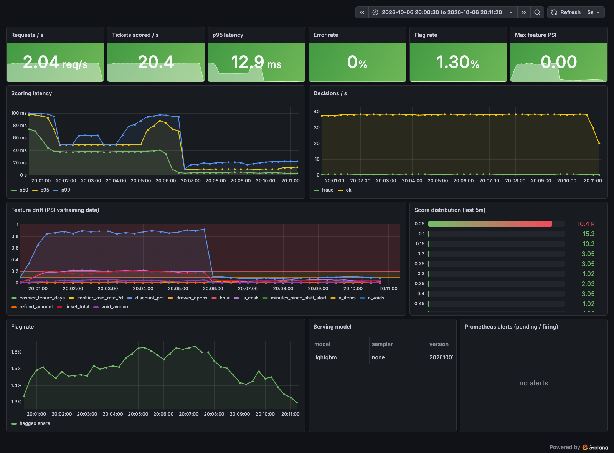
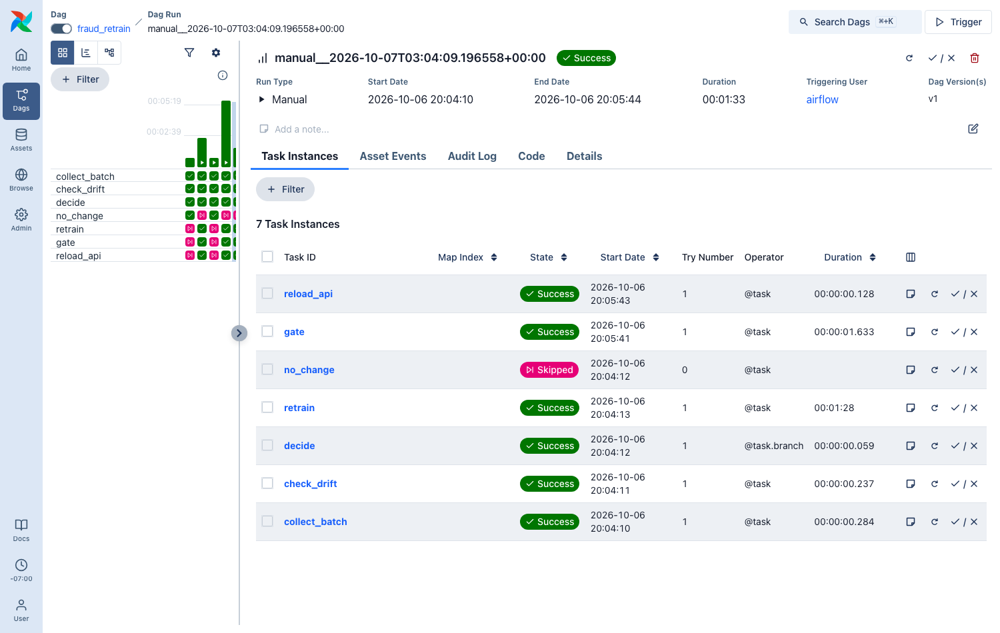
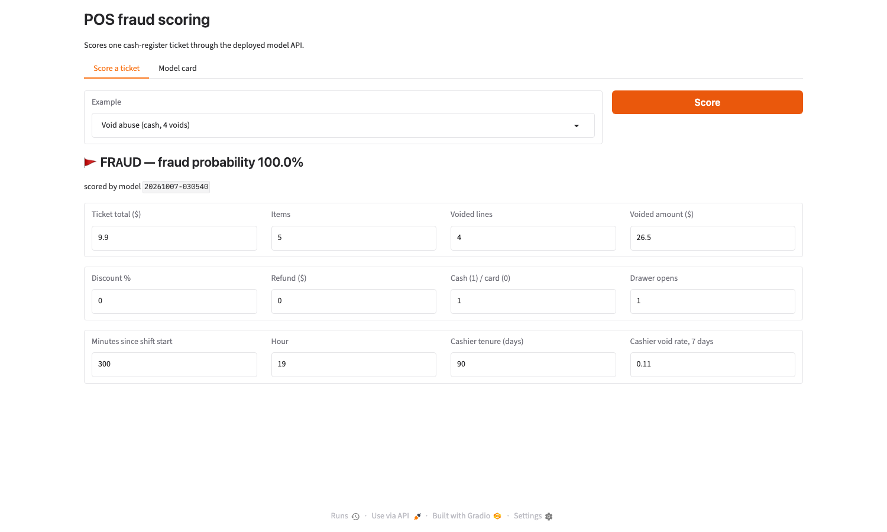

# pos-fraud-mlops

Fraud detection for restaurant point-of-sale (POS) tickets, built as a **complete MLOps loop**:
train → serve → monitor → detect drift → retrain → gate → hot-reload.

It is a public, reproducible version of the kind of system I built in production at ATP (POS fraud
detection, published at IEEE INISTA 2023): imbalanced data, tree ensembles with resampling, Airflow
orchestration and Grafana monitoring. The data here is synthetic, so anyone can run the full stack.

```
            ┌──────────── Airflow DAG (daily) ─────────────┐
 new tickets│ collect → PSI drift check ─┬─ stable → keep  │
            │                            └─ drift → retrain → champion/challenger gate ─┐
            └──────────────────────────────────────────────┘                            │ promote
                                                                                         ▼
 POS  ──► FastAPI /predict ──► fraud probability + decision        models/champion (bundle)
              │  /metrics                                                ▲  POST /admin/reload
              ▼                                                          │
         Prometheus ──► alert rules (drift, flag rate, p95, errors)      MLflow (every grid run)
              │
              ▼
          Grafana dashboard            Gradio demo (score a ticket, model card)
```

## What's inside

| Piece | What it does |
|---|---|
| `fraudops.data` | Synthetic POS tickets: void abuse, refund fraud, sweethearting, no-sale drawer opens (~1.5% fraud), plus legitimate look-alikes (manager comps, changed orders, real refunds). `drift` simulates a menu price rise and a promo period. |
| `fraudops.train` | Grid of **RandomForest / XGBoost / LightGBM × {none, ADASYN, Tomek links}**, selected by **PR-AUC** (accuracy is meaningless at 1.5% positives). Threshold = max F1 on validation; test metrics reported once. Every run logged to **MLflow**. |
| `fraudops.drift` | **PSI** per feature against reference bins saved with the model (handles binary and zero-inflated features). |
| `fraudops.api` | **FastAPI** scoring service. Prometheus metrics: request rate, latency histogram, errors, decisions, score distribution, per-feature PSI on a rolling window, loaded model version. `/admin/reload` swaps models without downtime. |
| `dags/fraud_retrain.py` | **Airflow 3** DAG: daily batch → drift check → branch → retrain → **champion/challenger gate** on a fresh holdout → reload the API. |
| `monitoring/` | Prometheus scrape + **alert rules** (drift, flag-rate band, p95 latency, error rate) and a provisioned **Grafana** dashboard. |
| `fraudops.demo` | **Gradio** app: score a ticket through the live API, see the model card and leaderboard. |
| `k8s/` | Deployment (rolling, probes, non-root), Service, **HPA**, PDB, model PVC and a training Job (kustomize). |
| `.github/workflows/ci.yml` | Lint, tests, a quality bar on a fresh training run (PR-AUC), manifest validation, image build. |

## Results

Model grid on 60k synthetic tickets (1.5% fraud), selected by validation PR-AUC:

| model | none | ADASYN | Tomek links |
|---|---|---|---|
| RandomForest | 0.823 | 0.727 | **0.824** |
| XGBoost | 0.803 | 0.787 | 0.798 |
| LightGBM | 0.820 | 0.794 | 0.819 |

Winner (RandomForest + Tomek links) on the untouched test split, at the F1-optimal threshold:
**PR-AUC 0.837 · precision 0.85 · recall 0.73 · F1 0.78**. Numbers move by a point or two between
machines (threading).

- **ADASYN hurt every model**: it creates synthetic minority points in exactly the regions where
  legitimate look-alikes (manager comps, changed orders, real refunds) live.
- **Tomek links** (cleaning the class boundary) was neutral to slightly positive, the same direction
  as in the published study.

**Drift scenario** (`--drift 0.8`: menu prices +28%, card share up, promo discounts):

| | max PSI | PR-AUC on the drifted holdout |
|---|---|---|
| champion trained on old data | 0.88 (`discount_pct`) → `FeatureDrift` alert | 0.698 |
| challenger retrained by the DAG | 0.10 after reload | **0.778** → promoted, hot-reloaded |







## Run it

```bash
docker compose up -d --build          # MLflow, first training, API, demo, Prometheus, Grafana
python scripts/loadgen.py --rps 40 --minutes 3               # normal traffic
python scripts/loadgen.py --rps 40 --minutes 4 --drift 0.8   # shifted traffic -> FeatureDrift alert

docker compose --profile airflow up -d   # Airflow at :8080
# trigger fraud_retrain with {"drift": 0.8} -> retrain, gate, reload
```

| UI | URL |
|---|---|
| API docs | http://localhost:8000/docs |
| Grafana | http://localhost:3001 |
| Prometheus | http://localhost:9090 |
| MLflow | http://localhost:5050 |
| Gradio demo | http://localhost:7860 |
| Airflow | http://localhost:8080 |

Local development:

```bash
uv venv && uv pip install -e ".[dev,demo]"
pytest -q
python -m fraudops.train --out models/candidate --promote-to models/champion
MODEL_DIR=models/champion uvicorn fraudops.api:app
```

Kubernetes (any cluster with a default StorageClass):

```bash
kubectl apply -k k8s && kubectl -n fraud wait --for=condition=complete job/fraud-train
kubectl -n fraud port-forward svc/fraud-api 8000:80
```

## Design notes

- **Why PR-AUC, not accuracy:** with 1.5% fraud, predicting "never fraud" scores 98.5% accuracy.
- **Why a champion/challenger gate:** retraining on drifted data is not automatically better; the
  candidate must beat the serving model on fresh labelled data before it is promoted.
- **Atomic promotion:** the new bundle is written next to the champion and swapped by directory
  rename, so the API never loads a half-written model.
- **Drift is monitored on inputs, not only on outcomes:** fraud labels arrive days later
  (chargebacks, audits); input drift is the early warning.
